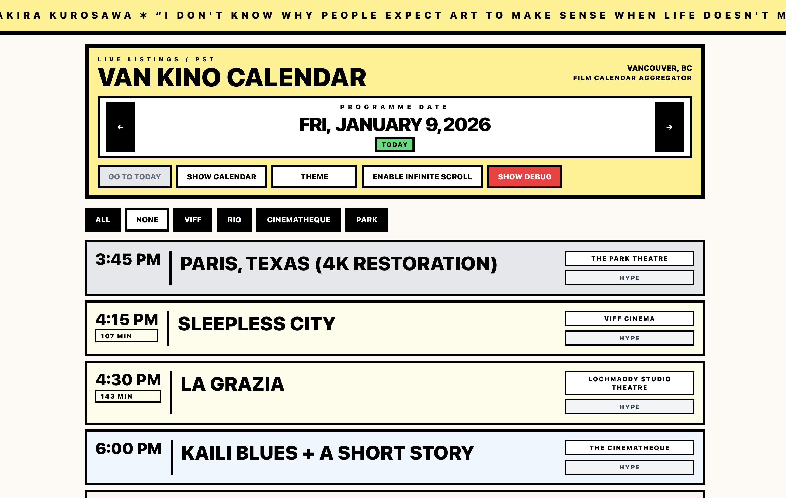

# Van Kino Calendar



Van Kino Calendar is a site (built with TanStack + Cloudflare Worker, deployed on Cloudflare) that scrapes and normalizes the daily film programs from VIFF Centre, Rio Theatre, The Cinematheque, and The Park Theatre into one feed.

## Development

```bash
pnpm install       # once
pnpm dev           # run Vite on http://localhost:3000
pnpm build         # SSR/client bundle
pnpm deploy        # build + wrangler deploy
```

> Tip: when Cloudflare D1 is available locally, bind it as `HYPE_DB`; otherwise hype counts simply stay in memory.

## VIFF festival listings

VIFF calendar screenings are grouped by their actual venue, including Vancouver
Playhouse, SFU Woodwards, Lindsay Family Stage, Alliance Française, Annex, and
The Pearl. Fifth Avenue and International Village remain available alongside
the existing independent cinemas. All venues start enabled. The VIFF festival
dropdown shows all festival films or narrows them to one theatre; regular venue
buttons return to that theatre’s full program.

The VIFF banner identifies films in the official festival program, independently
of the theatre. The server follows the festival program's pagination and caches
its film links for 15 minutes. Regular VIFF Centre films are not automatically
labelled festival selections. If the program cannot be fetched, saved VIFF
listings are retained; without a saved result, VIFF is marked unavailable. Matching screenings from other feeds are
merged with the VIFF listing using title, venue, and start time.

The public VIFF calendar token is retrieved automatically; no environment
variables are needed. Run `pnpm test` for festival parsing, venue mapping, and
screening merge regression tests.

## Listing cache

Each source/date result is stored in Cloudflare's Cache API for up to 24 hours,
with a 15-minute freshness window. Fresh hits skip upstream requests. Older hits
return immediately and refresh through Cloudflare `waitUntil`; failed refreshes
preserve the last successful value and timestamp and retry after one minute.
Successful empty schedules are cached normally. Sources that fail without a
saved result are shown as unavailable, while other sources still load.

The page shows the oldest source update time, including each day loaded through
infinite scroll. Background updates appear on the next page/date request.
The VIFF program catalog also uses this cache. Hype votes are not cached.
Cache keys are versioned under `/__listing-cache/v1/`; these are internal keys,
not public API routes. Increment the version when changing the stored format.

No KV, R2, paid plan, cron, or new environment variables are required. The Cache
API is local to each Cloudflare data center and entries can be evicted early.
Workers Free request/CPU limits still apply, including on cache misses; local
preview timings do not establish production CPU usage. Check Cloudflare's
[limits](https://developers.cloudflare.com/workers/platform/limits/) and
[Cache API documentation](https://developers.cloudflare.com/workers/runtime-apis/cache/).
